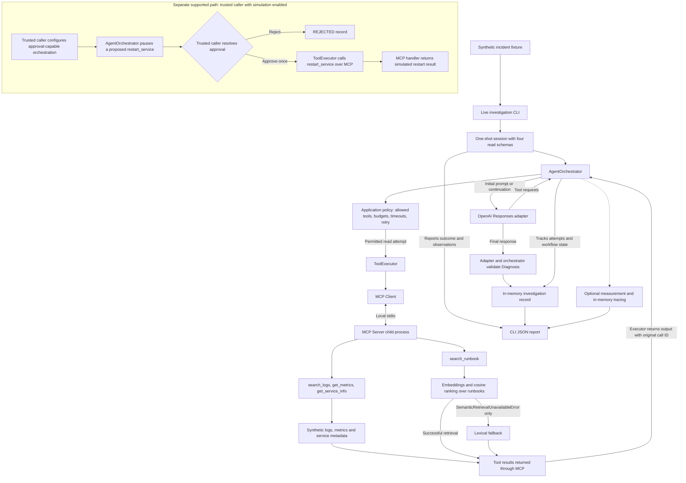
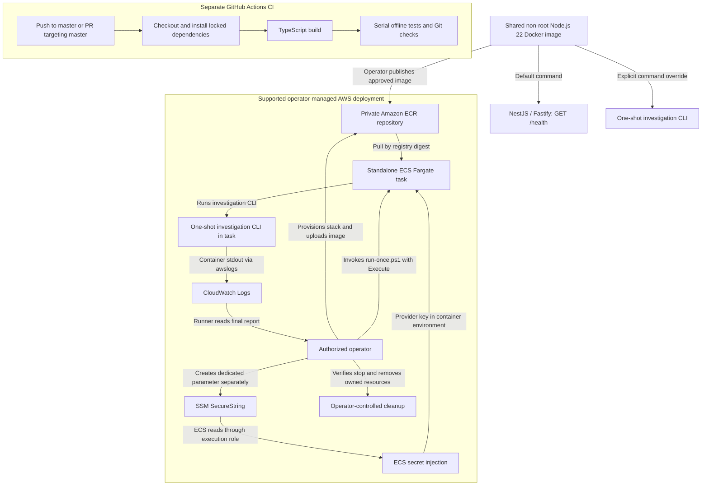

# IncidentOps Agent Architecture

## System Overview

IncidentOps Agent investigates synthetic service incidents. A single model chooses evidence to request and proposes a structured diagnosis. The application controls what runs, how long it waits, and how results enter the next model turn. The NestJS/Fastify process serves `GET /health`. A separate Node.js CLI selects an existing fixture by incident ID and requires explicit `--live` opt-in for provider calls.

Sources: [HTTP entry](../src/main.ts), [health controller](../src/health.controller.ts), [CLI entry](../src/run-investigation.ts), [incident fixtures](../src/fixtures/incidents.ts).

## Model Decision vs Application Control

### Diagram A — Investigation flow

The adapter supplies tool schemas to the OpenAI Responses API and maps model responses to tool calls or a final diagnosis. The orchestrator validates each model result and constructs continuations using the previous response ID and successful tool outputs. The live session constructs a read-only adapter, owns the MCP connection and shuts down its resources after the run.

Sources: [live session](../src/live-investigation.ts), [model adapter](../src/agent/openai-agent-model.ts), [orchestrator](../src/agent/agent-orchestrator.ts), [tool definitions](../src/agent/tool-definitions.ts).

## MCP and Operational Tools

`ToolExecutor` validates and routes allowed calls to the MCP client. The client starts a local Node.js child and communicates over stdio using the MCP SDK. Server handlers expose four operational reads. Log and metric queries filter synthetic observations, service lookup returns fixture metadata, and runbook search delegates to the retriever. The child reserves stdout for MCP transport.

Sources: [executor](../src/agent/tool-executor.ts), [MCP client](../src/mcp/client.ts), [stdio entry](../src/mcp/stdio-server.ts), [server registrations](../src/mcp/server.ts), [logs](../src/tools/search-logs.ts), [metrics](../src/tools/get-metrics.ts), [service metadata](../src/tools/get-service-info.ts).

## Retrieval and Evidence Flow

The live MCP child uses the OpenAI embedding adapter. The retriever ranks a small in-memory runbook corpus by cosine similarity. The runbook handler uses lexical matching only for an explicit semantic retrieval unavailability error. An empty semantic result or an unrelated failure does not trigger fallback. Successful tool output returns to the model under the original call ID. The final diagnosis has a summary, probable cause, confidence, evidence and recommended actions. Application validation checks its shape and content constraints. Recommendations are data.

Sources: [retriever](../src/rag/runbook-retriever.ts), [embedding adapter](../src/rag/openai-embedding-provider.ts), [diagnosis](../src/domain/diagnosis.ts), [investigation record](../src/domain/investigation.ts).

## Workflow Reliability and Approval

The live configuration allows five model turns and four tool attempts, with 30-second application waits for model responses and tool attempts. Each actual attempt consumes budget, including a retry. The retry policy permits one retry after a recognized timeout on an allowed read tool, subject to remaining budget. Runbook fallback stays within a single MCP attempt.

In approval-capable orchestration, a proposed `restart_service` pauses the investigation. A trusted application caller resolves the matching investigation and approval IDs. The orchestrator consumes approval before resuming. Rejection ends the workflow, and approval permits one simulated tool execution without automatic retry. The live CLI exposes only read tools and abandons an unexpected pending approval. Direct MCP access has no independent approval gate.

Sources: [orchestrator](../src/agent/agent-orchestrator.ts), [timeout](../src/agent/with-timeout.ts), [retry policy](../src/agent/tool-retry-policy.ts), [simulated restart](../src/tools/restart-service.ts), [approval tests](../test/approval.test.js).

## Runtime and AWS Deployment

### Diagram B — Runtime and deployment boundaries

Docker packages both entry points in the same image. The AWS template supports a digest-pinned task definition with an execution role for image pull, logging and access to the supplied secret reference. The operator provisions resources and publishes the image separately. The runner defaults to a local plan. Explicit execution starts one task, observes its stop and checks its final report. Stack, image and dedicated secret cleanup are operator responsibilities. The AWS diagram represents a supported configuration. A single real-provider INC-001 investigation ran in Fargate and the deployment resources were cleaned up.

Sources: [Dockerfile](../Dockerfile), [CloudFormation template](../deploy/aws/fargate.json), [run-once operator script](../deploy/aws/run-once.ps1), [AWS operator guide](../deploy/aws/README.md).

## CI and Testing Boundaries

The Ubuntu workflow sets up Node.js 22 and checks PowerShell 7 before installing dependencies, compiling TypeScript and running serial tests. Tests use fixtures, scripted models or mocked provider calls. AWS runner tests use a local fake CLI. CI performs no deployment. The Docker build test stage separately runs application tests with network access disabled for its build-and-test command. The Docker context excludes the AWS runner tests.

Sources: [CI workflow](../.github/workflows/ci.yml), [Docker context rules](../.dockerignore), [AWS runner tests](../test/aws-deployment.test.js), [live session tests](../test/live-investigation.test.js).

## Known Limitations

- Operational evidence is synthetic. The 30 scripted evaluation cases do not establish real LLM diagnosis accuracy. The AWS investigation is a single execution.
- Investigations and pending approvals live in memory. The simulated restart changes no infrastructure.
- Measurements capture application-side elapsed waits and observed model response usage. Embedding usage and final billing are outside those totals.
- The tracing integration is optional in the orchestrator. The live session collects OpenTelemetry spans in memory and includes a snapshot in the report. There is no external trace backend or distributed MCP trace.
- An application timeout bounds caller wait. Underlying work can continue even if the caller requests cancellation.
- AWS final billing reconciliation remains pending.

Sources: [evaluation dataset](../src/evaluation/expanded-dataset.ts), [measurement collector](../src/measurement/collector.ts), [local tracing](../src/tracing/local.ts), [timeout implementation](../src/agent/with-timeout.ts).
